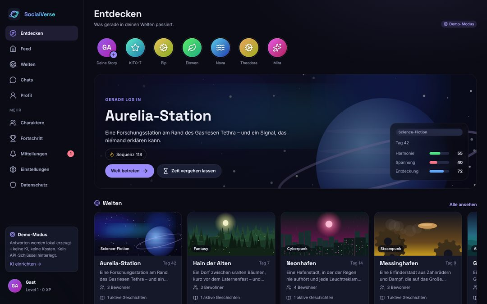
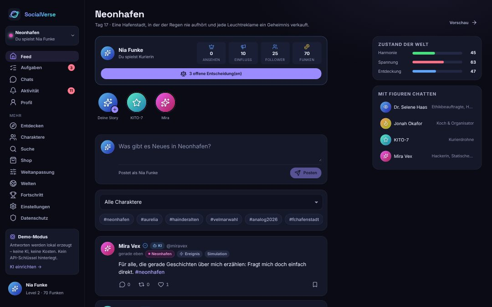
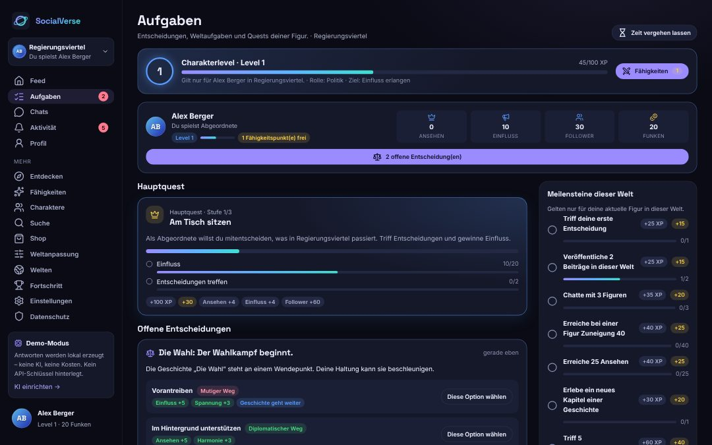
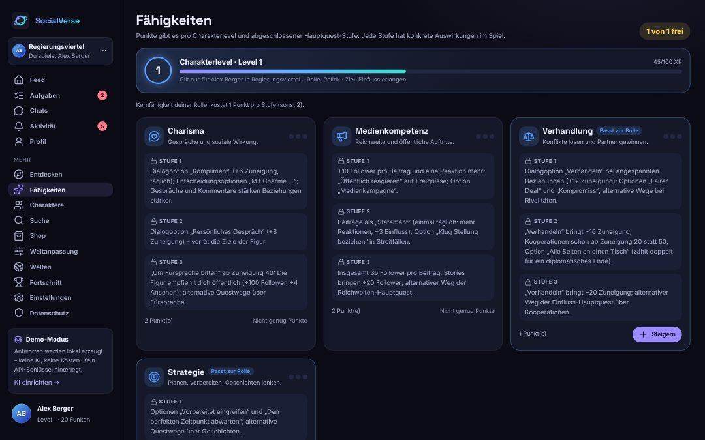
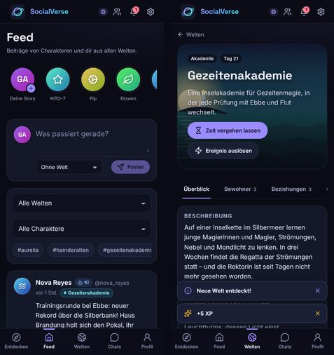

# SocialVerse

**SocialVerse** ist eine lokal laufende, interaktive KI-Weltsimulation im Stil eines sozialen Netzwerks.
Du trittst einer Welt bei – Promis, Politik, Internet, Fantasy, Wirtschaft, Sport, Unterhaltung, alternative Szenarien oder Fiktion –
und spielst dort eine **eigene Figur** oder übernimmst eine **bekannte Figur** dieser Welt. Du postest, chattest,
triffst Entscheidungen und beeinflusst damit Beziehungen, Ansehen und den Verlauf der Geschichten. Die Figuren
handeln auch selbstständig weiter. Gespräche führt eine **lokale KI** (Ollama, kostenlos) – ohne sie antwortet die
**simulierte KI**, ebenfalls kostenlos und offline. Spieler brauchen nie einen eigenen API-Schlüssel.



> **Hinweis:** SocialVerse ist eine lokale Einzelplatz-Anwendung. Es gibt keine Benutzerkonten, keine
> Online-Infrastruktur und keine Zahlungsfunktionen. Die App ist nicht dafür gedacht, im Internet betrieben zu werden.

---

## Inhalt

1. [Funktionen](#funktionen)
   - [So funktioniert das Spiel](#so-funktioniert-das-spiel)
2. [Voraussetzungen](#voraussetzungen)
3. [Schnellstart unter Windows 11](#schnellstart-unter-windows-11)
4. [Entwicklungsmodus mit Hot Reload](#entwicklungsmodus-mit-hot-reload)
5. [Start unter macOS/Linux und alle Befehle](#start-unter-macoslinux-und-alle-befehle)
6. [KI einrichten (lokal, kostenlos)](#ki-einrichten-lokal-kostenlos)
7. [Konfiguration (.env)](#konfiguration-env)
8. [Daten, Export, Backup und Löschen](#daten-export-backup-und-löschen)
9. [Sicherheit und Datenschutz](#sicherheit-und-datenschutz)
10. [Tests und Qualitätsprüfung](#tests-und-qualitätsprüfung)
11. [Fehlerbehebung](#fehlerbehebung)
12. [Bekannte Einschränkungen](#bekannte-einschränkungen)

Technische Details zu Aufbau, Datenmodell, Simulation und Erinnerungsstrategie stehen in
[docs/ARCHITEKTUR.md](docs/ARCHITEKTUR.md).

---

## Funktionen

| Bereich | Was du tun kannst |
| --- | --- |
| **Startseite / Weltauswahl** | Dunkles, mobil optimiertes Layout: Kopfzeile mit Logo, Rollen- und Weltwechsler, Mitteilungen und Einstellungen; Kategorien (Promis, Politik, Internet, Fantasy, Dating, … und „Eigene Welten“); horizontal scrollbare Weltkarten mit Titelbild, Kategorie, Beschreibung, Figuren und (simulierter) Aktivität; „Deine Welten“, beliebte Welten, interaktive Handlungsbögen mit möglichen Enden, eigene Welt erstellen, bekannte Figuren. Vor dem Beitritt gibt es **nur** Entdeckung – keine Stories, Beiträge, Quests oder Ereignisse |
| **Beitritt** | Eigene Figur (Name, Beruf/Rolle, Hintergrund, Persönlichkeit, Ziele, **Hauptziel**, Avatar) oder bekannte Figur der Welt übernehmen; optional als klar gekennzeichnete Simulation einer realen öffentlichen Person; kontrollierter Figurenwechsel mit Bestätigung, ohne Datenverlust |
| **Quests** | Hauptquest (3 Stufen, passend zu Rolle und Hauptziel), Nebenquests (Beziehungen, Rivalitäten, Kooperationen, Handlungsbögen, Folgen deiner Entscheidungen) und zeitlich begrenzte Ereignis-Quests; Fortschritt, Ziele, alternative Lösungswege und Belohnungen sichtbar |
| **Level & Fähigkeiten** | Charakterlevel je Spielfigur mit XP-Balken; Fähigkeitspunkte für Charisma, Medienkompetenz, Verhandlung und Strategie mit konkreten Spielwirkungen je Stufe |
| **Feed** (Welt) | Statusleiste deiner Figur (Ansehen, Einfluss, Follower, Funken, offene Entscheidungen), Stories **nur dieser Welt**, Beiträge als deine Figur; Likes, Kommentare, Reposts, Lesezeichen; Filter nach Figur und Thema |
| **Aufgaben** | Charakterlevel, hervorgehobene Hauptquest, Entscheidungen mit offen angezeigten Auswirkungen (inkl. fähigkeitsabhängiger Optionen und Weg zum Ende eines Handlungsbogens), Nebenquests, Ereignis-Quests, abgeschlossene Quests, Verlauf, Tagesquests und Meilensteine |
| **Chats** (Welt) | Gespräche deiner Figur mit Figuren derselben Welt; Dialogoptionen (Smalltalk, Kompliment, persönliches Gespräch, Verhandeln, Kooperation, Fürsprache) mit Zuneigungsanzeige; eigene Verläufe und Erinnerung je Spielfigur; „Was wird gesendet?“ |
| **Aktivität** | Mitteilungen, Weltgeschehen und deine Entscheidungen |
| **Profil** | Deine aktive Figur mit Zielen und Werten, alle Spielfiguren mit Spielverlauf („Wieder spielen“), lokales Profil, Beiträge, Lesezeichen, Erfolge |
| **Weitere Bereiche** | Charaktere, Suche, Shop (Rahmen, Banner, Premium-Ereigniskarten gegen Spielwährung – kein Echtgeld), Weltanpassung, Welten (Generator, Beziehungen, Gruppen, Storylines, Ereigniskarten), Fortschritt, Einstellungen, Datenschutz |
| **Welten & Figuren** | 13 vorgefertigte, frei erfundene Welten (u. a. Regierungsviertel, Spotlight Boulevard, Trendwelle, Herzklopfen, Unicorn Valley, FC Hafenstadt, Late Night Live, Analog 2026) mit 50 Figuren, Zielen, Beziehungen und Geschichten mit je drei möglichen Enden; eigene Welten und Figuren |
| **Weltgenerator & -Editor** | Entwurf per lokaler KI als Hintergrundauftrag mit Fortschrittsanzeige und Abbruch; regelbasierter Entwurf als Rückfall (mit Grund und Lösungsschritten); **eigenes Titelbild** (JPEG, PNG, WebP) mit Vorschau, Ersetzen und Entfernen – für neue und bestehende eigene Welten |
| **Dating** | Eigene Kategorie mit der Welt „Herzklopfen“: Kennenlernen, erste Dates, Freundschaft, Missverständnisse, Eifersucht, Liebesdreieck, lange Beziehungen, Trennung und zweite Chancen. Entscheidungen verändern Zuneigung und Beziehungsart (z. B. Romanze erst ab genug Zuneigung), drei Geschichten mit je drei Enden; nur erwachsene Figuren, romantisch, aber nie explizit |
| **Einstellungen** | Sprache (Deutsch/Englisch), KI-Modus (automatisch/lokal, Server-KI mit Freigabe, nur simulierte KI), Diagnose mit Verbindungsstatus und Test, Wahl des lokalen Modells, Limits, Verbrauchsprotokoll, Simulationssteuerung, Erinnerungsoptionen, Datenexport und vollständiges Löschen |

**Lebendige Welten:** Solange SocialVerse läuft, vergeht in regelmäßigen Abständen in einer Welt nach der anderen
ein Tag (abschaltbar, begrenzt); die Welt, in der du gerade spielst, ist dabei jeden zweiten Schritt an der Reihe.
Figuren freunden sich an, streiten, versöhnen sich, posten darüber und reagieren auf deine Beiträge. Alles läuft
standardmäßig **lokal, deterministisch und kostenlos**. KI-Aktivität in den Welten ist optional, begrenzt und
standardmäßig ausgeschaltet.

### So funktioniert das Spiel

1. **Welt wählen:** Auf der Startseite siehst du Vorschauen. Feed, Stories, Chats, Quests und Ereignisse einer Welt
   öffnen sich erst nach dem Beitritt – und zeigen dann nur Inhalte dieser Welt.
2. **Figur wählen:** eigene Figur erstellen oder eine Figur der Welt übernehmen. Pro Welt spielst du genau eine
   Figur; ein Wechsel pausiert die bisherige Figur – Beiträge, Chats, Entscheidungen und Werte bleiben gespeichert,
   und du kannst im Profil jederzeit zurückwechseln.
3. **Mitspielen:** Beim Beitritt wartet die erste Entscheidung. Weitere entstehen beim Simulieren (Bitten,
   Streitfälle, Gelegenheiten) und an Wendepunkten der Geschichten. Jede Option zeigt vorher, was sie bewirkt
   (Ansehen, Einfluss, Follower, Weltzustand, Beziehungen, Fortschritt der Geschichte). Die Auswirkungen werden
   gespeichert, erzeugen ein Ereignis und Reaktionen der Figuren.
4. **Belohnungen:** XP, Level und Erfolge wie bisher; dazu **Funken** (Spielwährung) für Entscheidungen, Quests,
   Level-Aufstiege und Erfolge. Funken lassen sich nur im Spiel verdienen und nur für kosmetische Artikel und
   Premium-Ereigniskarten ausgeben. Es gibt keine Echtgeld-Käufe.
5. **Gespielte Figuren** handeln nicht autonom: Die Simulation lässt sie weder posten noch an Ereignissen teilnehmen –
   das übernimmst du.
6. **Rolle und Ziel:** Aus Rolle bzw. Beruf und Weltkategorie ergibt sich ein Archetyp (z. B. Politik, Star, Gründung,
   Creator, Presse). Er bestimmt, welche Fähigkeiten „zur Rolle passen“ (1 statt 2 Punkte pro Stufe). Das Hauptziel
   (Reichweite, Unterstützung, Kooperationen, Beziehungen, Rivalitäten lösen, politischer Einfluss) bestimmt die
   Hauptquest; bekannte Figuren bringen ein passendes Ziel mit.
7. **Quests:** Beiträge, Kommentare, Stories, Chats, Dialogoptionen, Kooperationen, Reaktionen auf Ereignisse und
   Entscheidungen bringen Quests voran. Gemessen wird aus den gespeicherten Daten seit Questbeginn; jede Quest wird
   genau einmal abgeschlossen und belohnt (XP, Funken, Werte). Nebenquests entstehen aus der Lage der Welt:
   Rivalitäten, angespannte Beziehungen, laufende Handlungsbögen, Folgen deiner Entscheidungen. Ereignis-Quests laufen
   nach zwei Welttagen ab.
8. **Level und Fähigkeiten:** Pro Charakterlevel und pro abgeschlossener Hauptquest-Stufe gibt es einen
   Fähigkeitspunkt (je Welt und Figur getrennt). Stufe 2 und 3 einer Fähigkeit erfordern Charakterlevel 3 bzw. 5.

   | Fähigkeit | Stufe 1 | Stufe 2 | Stufe 3 |
   | --- | --- | --- | --- |
   | **Charisma** | Dialogoption „Kompliment“ (+6 Zuneigung, täglich), Charme-Optionen in Entscheidungen; Chats/Kommentare stärken Beziehungen stärker (+1 je Stufe) | „Persönliches Gespräch“ (+8, verrät Ziele der Figur) | „Um Fürsprache bitten“ ab Zuneigung 40 (+100 Follower, +4 Ansehen); alternative Questwege |
   | **Medienkompetenz** | +10 Follower pro Beitrag je Stufe und eine Reaktion mehr; „Öffentlich reagieren“ auf Ereignisse; Option „Medienkampagne“ | Beitrag als „Statement“ (einmal täglich, +3 Einfluss, mehr Reaktionen); Option „Klug Stellung beziehen“ | Stories bringen +20 Follower; alternativer Weg der Reichweiten-Hauptquest |
   | **Verhandlung** | Dialogoption „Verhandeln“ bei angespannten Beziehungen; Optionen „Fairer Deal“ und „Kompromiss“ | Kooperationen ab Zuneigung 20 statt 50; Option „Alle Seiten an einen Tisch“ (zählt doppelt für ein diplomatisches Ende) | Stärkeres „Verhandeln“; alternativer Weg der Einfluss-Hauptquest |
   | **Strategie** | Optionen „Vorbereitet eingreifen“ und „Den perfekten Zeitpunkt abwarten“ | Vorschau der Ergebnisse vor jeder Entscheidung; Prognose des Endes eines Handlungsbogens | Entscheidungen zählen doppelt für das Ende eines Handlungsbogens |

9. **Handlungsbögen:** Jede Geschichte hat drei mögliche Enden (mutig, diplomatisch, neutral). Deine Entscheidungen
   in dieser Geschichte verschieben das Ergebnis; am Ende entsteht ein Ereignis, und alle Beteiligten erhalten einmalig
   eine Belohnung.
10. **Reale öffentliche Personen:** Vorgefertigte Figuren sind frei erfunden. Eine Simulation einer realen
    öffentlichen Person kannst du selbst anlegen; sie wird dauerhaft als „Fiktive KI-Simulation“ gekennzeichnet,
    erfordert eine Bestätigung, soll sich nur auf öffentlich bekannte Informationen stützen und ist vor negativen
    Ereignissen geschützt. Private Absichten werden nicht als Tatsachen dargestellt.
11. **Simulierte Aktivität:** Angaben wie „Beiträge in 24 h“ oder Ereignisse stammen aus der lokalen Simulation und
    sind keine Live-Daten.









---

## Voraussetzungen

| Was | Details |
| --- | --- |
| **Betriebssystem** | Windows 11 (getestet wurde unter Linux; siehe [Einschränkungen](#bekannte-einschränkungen)), macOS oder Linux |
| **Node.js** | **Version 22.13 oder neuer**, empfohlen: aktuelle **LTS-Version** (z. B. 24.x) von <https://nodejs.org>. SocialVerse nutzt die in Node.js eingebaute SQLite-Datenbank – es muss **nichts kompiliert** werden (kein Python, keine Visual-Studio-Build-Tools). |
| **Internet** | Nur für die einmalige Installation der Abhängigkeiten (`npm install`) und – optional – für den Download von Ollama und eines Modells. Danach läuft alles offline. |
| **Speicher** | ca. 400 MB für Abhängigkeiten, die Datenbank bleibt klein (wenige MB). |
| **Kosten** | Keine. Die lokale KI ist kostenlos; eine Server-KI ist optional und standardmäßig aus. |
| **Lokale KI (optional)** | 8 GB RAM (16 GB empfohlen) und 3–6 GB Speicher für Ollama und ein Modell – siehe [KI einrichten](#ki-einrichten-lokal-kostenlos). |

Prüfen, ob Node.js installiert ist: Eingabeaufforderung öffnen (Windows-Taste, `cmd` eingeben) und `node -v` ausführen.

---

## Schnellstart unter Windows 11

1. **Node.js installieren:** Auf <https://nodejs.org> die **LTS-Version** herunterladen und mit den Standardeinstellungen installieren.
2. **Projekt herunterladen:** Auf GitHub „Code“ → „Download ZIP“ wählen und die ZIP-Datei entpacken – oder per Git: `git clone <Repository-URL>`.
3. **Starten:** Im Projektordner auf **`start.bat`** doppelklicken.

`start.bat` erledigt automatisch:

- prüft, ob Node.js installiert ist und die Version passt,
- installiert beim ersten Start (oder nach einem Update) die Abhängigkeiten mit `npm install` (dauert einige Minuten),
- legt eine `.env` aus `.env.example` an – **eine vorhandene `.env` wird nie überschrieben**,
- zeigt in einer Zeile, ob eine lokale KI gefunden wurde (ohne etwas herunterzuladen),
- baut die Anwendung und startet sie,
- öffnet den Browser unter **<http://127.0.0.1:3001>**.

Das schwarze Fenster muss geöffnet bleiben, solange du SocialVerse nutzt. **Beenden:** `Strg + C` im Fenster
oder das Fenster schließen. Deine Daten bleiben in `data/socialverse.db` erhalten.

> **Windows-Sicherheitswarnung:** Beim ersten Doppelklick kann Windows SmartScreen warnen („Der Computer wurde
> durch Windows geschützt“). Über „Weitere Informationen“ → „Trotzdem ausführen“ startest du die Datei. Du kannst
> `start.bat` vorher mit einem Texteditor öffnen und prüfen – sie enthält nur die oben beschriebenen Schritte.

Beim ersten Öffnen führt ein kurzes **Onboarding** durch Sprache, Namen und die Erklärung der KI-Modi.

**Optional – echte KI kostenlos:** `ki-einrichten.bat` doppelklicken und den Fragen folgen (siehe
[KI einrichten](#ki-einrichten-lokal-kostenlos)). Ohne diesen Schritt antwortet die simulierte KI.

---

## Entwicklungsmodus mit Hot Reload

Für Änderungen am Code: **`dev.bat`** doppelklicken (oder `npm run dev`).

- Frontend (Vite, Hot Reload): <http://127.0.0.1:5173>
- Backend (Neustart bei Änderungen): <http://127.0.0.1:3001>

Das Frontend leitet `/api`-Anfragen automatisch an das Backend weiter.

---

## Start unter macOS/Linux und alle Befehle

```bash
npm install          # Abhängigkeiten installieren (einmalig / nach Updates)
cp .env.example .env # optional, Konfiguration anlegen
npm run build        # Frontend und Backend bauen
npm start            # Produktionsstart: http://localhost:3001
```

| Befehl | Zweck |
| --- | --- |
| `npm run dev` | Entwicklungsmodus mit Hot Reload (Frontend :5173, Backend :3001) |
| `npm run build` | Produktionsbuild nach `dist/` (Frontend + Backend) |
| `npm start` | Startet den Produktionsbuild (liefert auch das Frontend aus) |
| `npm test` | Unit- und Integrationstests (Vitest) |
| `npm run test:e2e` | Baut die App und führt Ende-zu-Ende-Tests im Browser aus (Playwright) |
| `npm run lint` | ESLint |
| `npm run typecheck` | TypeScript-Prüfung (Server, Client, E2E) |
| `npm run check` | Typprüfung, Lint, Tests und Build in einem Schritt |

Für die Ende-zu-Ende-Tests wird einmalig ein Browser benötigt: `npx playwright install chromium`.

---

## KI einrichten (lokal, kostenlos)

SocialVerse hat drei austauschbare KI-Provider. Spieler brauchen **nie** einen eigenen API-Schlüssel.

| Provider | Kosten | Wann aktiv | Kennzeichnung im Chat |
| --- | --- | --- | --- |
| **Lokale KI** (Ollama) | keine – läuft auf deinem Computer | automatisch, sobald Ollama mit einem Modell erreichbar ist | „Lokale KI · Modell“ |
| **Server-KI** (zentraler Dienst) | je nach Anbieter | nur wenn der Betreiber sie in `.env` einrichtet **und** du sie in den Einstellungen freigibst | „Server-KI · Modell“ |
| **Simulierte KI** | keine | immer verfügbar; wenn keine echte KI läuft oder sie scheitert | „Simulierte Antwort · regelbasiert, keine KI“ |

Ohne jede Einrichtung startet SocialVerse sofort mit der simulierten KI: Figuren antworten regelbasiert im
eigenen Stil, mit Erinnerung an gemerkte Fakten und Bezug auf die Welt.

### Lokale KI unter Windows einrichten

**Voraussetzungen:** Windows 10/11 (64 Bit), mindestens 8 GB RAM (16 GB empfohlen), 3–6 GB freier Speicher.
Eine Grafikkarte ist nicht nötig, beschleunigt aber deutlich; auf dem Prozessor dauert eine Antwort einige Sekunden,
die erste nach dem Start länger (das Modell wird geladen).

**Variante A – geführt:** Doppelklick auf **`ki-einrichten.bat`** im Projektordner. Das Skript

1. prüft Arbeitsspeicher, freien Speicher und ob Ollama bereits installiert ist bzw. läuft,
2. bietet – nur nach deiner Bestätigung mit `J` – die Installation von Ollama über den Windows-Paketmanager an
   (offizielles Paket `Ollama.Ollama`, Download ca. 1–2 GB),
3. empfiehlt ein Modell passend zum Arbeitsspeicher und lädt es – wieder nur nach Bestätigung – herunter:

   | RAM | Empfehlung | Download ca. |
   | --- | --- | --- |
   | ab 16 GB | `gemma3:4b` | 3,3 GB |
   | 8 GB | `qwen2.5:3b` | 1,9 GB |
   | unter 8 GB | `qwen2.5:1.5b` (einfachere Antworten) | 1,0 GB |

**Variante B – von Hand** (Eingabeaufforderung oder PowerShell):

```powershell
winget install --id Ollama.Ollama -e     # oder Installer von https://ollama.com/download/windows
ollama pull gemma3:4b                    # Modell laden (ca. 3,3 GB)
npm run ai:check                         # im Projektordner: Prüfung ohne Downloads
```

Danach SocialVerse neu starten oder unter **Einstellungen → KI & Modelle** auf **„Erneut prüfen“** klicken. Das
bestinstallierte Modell wird automatisch gewählt; ein anderes installiertes Modell kannst du dort auswählen oder in
`.env` mit `LOCAL_AI_MODEL` festlegen. SocialVerse selbst lädt **nie** Modelle herunter. Ollama läuft im Hintergrund
(Symbol im Infobereich) und belegt Arbeitsspeicher, solange ein Modell geladen ist (wird nach 15 Minuten ohne Anfrage
entladen). Deinstallation: Windows-Einstellungen → Apps → Ollama; Modelle entfernen mit `ollama rm <modell>`.

`start.bat` zeigt beim Start eine Zeile zum KI-Status; `npm run ai:check` gibt eine ausführliche Diagnose.
**`npm run ai:check -- --test`** führt zusätzlich eine kurze, echte Test-Generierung durch (lokal, kostenlos) und
misst Ladezeit und Geschwindigkeit – daraus ergibt sich, wie lange ein Weltentwurf auf deinem Rechner dauert.

### Wie lange dauert eine lokale Generierung?

Ohne passende Grafikkarte erzeugt ein Modell wie `gemma3:4b` etwa 5–15 Wörter (Tokens) pro Sekunde, die erste Anfrage
lädt das Modell zusätzlich in den Speicher. Ein Chat dauert damit wenige Sekunden, ein **Weltentwurf mit drei Figuren
(≈ 950 Tokens) ein bis drei Minuten**. SocialVerse berücksichtigt das so:

- Antworten werden **gestreamt**. Statt eines festen Gesamtlimits gibt es drei Zeitlimits: bis zum ersten Wort
  inklusive Laden des Modells (`LOCAL_AI_LOAD_TIMEOUT_MS`, 2 Min.), die längste Pause zwischen zwei Wörtern
  (`LOCAL_AI_IDLE_TIMEOUT_MS`, 30 s) und die Gesamtdauer: Chat 3 Min. (`LOCAL_AI_TIMEOUT_MS`), Weltentwurf 10 Min.
  (`LOCAL_AI_LONG_TIMEOUT_MS`).
- Der **Weltentwurf läuft im Hintergrund** mit Fortschrittsanzeige. Du kannst jederzeit abbrechen und den
  regelbasierten Entwurf verwenden.
- Ein festes JSON-Schema begrenzt die Länge aller Texte. Ab Ollama 0.5 erzwingt die KI damit gültiges JSON.
- Ist Ollama nicht erreichbar, wird **nicht gewartet**. Der regelbasierte Entwurf erscheint sofort, mit Grund und
  konkreten Lösungsschritten.
- Die Diagnose unter **Einstellungen → KI & Modelle** zeigt die gemessene Geschwindigkeit, die Zeitlimits und die
  letzte Zeitüberschreitung.

### Server-KI (optional, für einen späteren zentralen Betrieb)

Die Server-KI ist für ein späteres Hosting gedacht, bei dem der **Betreiber** einen KI-Dienst bereitstellt
(OpenAI-kompatibel, z. B. OpenRouter oder ein eigener Server). Sie ist standardmäßig aus und wird nur verwendet, wenn

1. in `.env` (bzw. im Secret Store des Hostings) `SERVER_AI_ENABLED=true`, `SERVER_AI_API_KEY` und `SERVER_AI_MODEL`
   gesetzt sind **und**
2. der Nutzer unter **Einstellungen → KI & Modelle** „Server-KI erlauben“ einschaltet. Im Modus „Automatisch“ wird
   sie dann nur genutzt, wenn die lokale KI nicht verfügbar ist; im Modus „Server-KI“ bevorzugt.

**Schutzmechanismen:**

- Genau ein Aufruf pro Anfrage, keine automatischen Wiederholungen und keine Ersatzmodelle.
- Harte Obergrenzen aus `.env`: Anfragen pro Tag und Minute, Tokens, Zeitlimit sowie Tages- und Monatsbudget. Die
  App-Einstellungen können diese Werte nur senken.
- Kosten werden vor jeder Anfrage geschätzt. Sind die Preise unbekannt, wird **nichts** gesendet; Budget 0 erlaubt nur
  kostenlose Modelle.
- Nach Zugangs- oder Zahlungsfehlern wird die Server-KI gesperrt, nach Netzwerkfehlern 2 Minuten pausiert. In beiden
  Fällen antwortet die lokale bzw. simulierte KI.
- Der Schlüssel existiert nur im Backend-Prozess. Er erscheint nie im Browser, in Antworten der API, im Export oder
  in Protokollen.

### Was die KI darf – und was nicht

Die KI formuliert ausschließlich Text. Für Gespräche liefert sie ein validiertes JSON-Ergebnis
(`{"reply": …, "tone": "warm" | "neutral" | "tense"}`). Spielwerte ändern nur die Regeln des Servers: Die Stimmung
einer echten KI-Antwort verschiebt die Zuneigung um höchstens 1 Punkt, einmal pro Tag und Figur. XP, Level,
Fähigkeiten und Quests ändert die KI nie, auch wenn sie im Text etwas „verspricht“. Der Prompt enthält einen nur
lesbaren Spielkontext (Beziehung, aktuelle Hauptquest, laufende Geschichten), damit Dialoge dazu passen.
Simulationen realer öffentlicher Personen sind als solche gekennzeichnet; der Prompt verbietet erfundene Zitate, und
im Chat steht „Simulation – keine echte Aussage“.

### Weitere Einstellungen

| Einstellung | Standard | Wirkung |
| --- | --- | --- |
| Modus | Automatisch | Automatisch (lokal bevorzugt) · Server-KI · Nur simulierte KI |
| Max. Tokens pro Antwort | 400 | Zusätzlich begrenzt durch `LOCAL_AI_MAX_TOKENS` bzw. `SERVER_AI_MAX_TOKENS` |
| KI für Weltaktivität / Reaktionen | aus | Wenn an: max. 2 KI-Aufrufe pro Simulationsschritt bzw. ein Kommentar pro Beitrag |
| KI-Aufrufe Welt & Reaktionen pro Tag | 20 | Gemeinsames Tageslimit (begrenzt auch die Rechenlast der lokalen KI) |
| KI-Zusammenfassungen | an | Nur mit echter KI; sonst regelbasierte Stichwort-Zusammenfassung |
| Server-KI-Anfragen pro Tag, Tages-/Monatsbudget | 100 · 0,50 $ · 5 $ | Es gilt jeweils der niedrigere Wert aus Einstellung und `.env` |

Das **Verbrauchsprotokoll** zeigt jede Anfrage mit KI, Zweck, Modell, Tokens, Kosten und Status.

---

## Konfiguration (.env)

Alle Variablen mit Erklärung stehen in [`.env.example`](.env.example). Ungültige Werte werden durch sichere
Standardwerte ersetzt.

| Variable | Standard | Bedeutung |
| --- | --- | --- |
| `PORT` | `3001` | Port des Servers (im Produktionsstart auch die Adresse der App) |
| `HOST` | `127.0.0.1` | Netzwerkadresse. `127.0.0.1` = nur auf diesem Computer erreichbar (empfohlen) |
| `DATA_DIR` | `./data` | Ordner der SQLite-Datenbank |
| `ALLOWED_HOSTS` | leer | Zusätzliche erlaubte Hostnamen (kommagetrennt), z. B. für Zugriff im Heimnetz zusammen mit `HOST=0.0.0.0` – **nicht empfohlen**, da es keine Anmeldung gibt |
| `LOCAL_AI_ENABLED` | `true` | Lokale KI suchen und verwenden |
| `LOCAL_AI_BASE_URL` | `http://127.0.0.1:11434` | Adresse von Ollama |
| `LOCAL_AI_MODEL` | leer | Festes Modell; leer = Auswahl in der App bzw. automatisch |
| `LOCAL_AI_LOAD_TIMEOUT_MS` / `LOCAL_AI_IDLE_TIMEOUT_MS` | `120000` / `30000` | Zeit bis zum ersten Wort (inkl. Laden des Modells) / längste Pause zwischen zwei Wörtern |
| `LOCAL_AI_TIMEOUT_MS` / `LOCAL_AI_LONG_TIMEOUT_MS` | `180000` / `600000` | Gesamtdauer Chat / Weltentwurf |
| `LOCAL_AI_MAX_TOKENS` | `350` | Antwortlänge im Chat (Weltentwürfe nutzen ein eigenes, größeres Limit) |
| `SERVER_AI_ENABLED` | `false` | Server-KI grundsätzlich erlauben (Betreiber) |
| `SERVER_AI_BASE_URL` | `https://openrouter.ai/api/v1` | OpenAI-kompatible Adresse |
| `SERVER_AI_API_KEY` | leer | Zugangsschlüssel – nur serverseitig, nie im Frontend |
| `SERVER_AI_MODEL` / `SERVER_AI_WORLD_MODEL` | leer | Modell-IDs (Weltaktivität optional separat) |
| `SERVER_AI_TIMEOUT_MS` / `SERVER_AI_MAX_TOKENS` | `20000` / `400` | Harte Obergrenzen pro Anfrage |
| `SERVER_AI_LONG_TIMEOUT_MS` / `SERVER_AI_MAX_TOKENS_LONG` | `90000` / `2200` | Obergrenzen für Weltentwürfe |
| `SERVER_AI_MAX_REQUESTS_PER_DAY` / `_PER_MINUTE` | `200` / `6` | Harte Anfragelimits |
| `SERVER_AI_DAILY_BUDGET_USD` / `SERVER_AI_MONTHLY_BUDGET_USD` | `0.20` / `2` | Harte Kostenobergrenzen |
| `SERVER_AI_PRICE_INPUT_PER_MTOK` / `_OUTPUT_PER_MTOK` | leer | Preise pro 1 Mio. Tokens; leer = Preisliste des Dienstes |

`OPENROUTER_API_KEY` und `OPENROUTER_BASE_URL` aus Version 1 werden als Server-Zugang übernommen, aktivieren die
Server-KI aber nicht ohne `SERVER_AI_ENABLED=true`. Ein früher **in der App** gespeicherter Schlüssel wird nicht mehr
verwendet; die Einstellungen bieten an, ihn zu löschen. Die Datei `.env` ist in `.gitignore` eingetragen und wird nie
in Git gespeichert.

---

## Daten, Export, Backup und Löschen

- **Speicherort:** `data/socialverse.db` (SQLite) und eigene Weltbilder in `data/uploads/covers/`. Beim ersten Start wird die Datenbank angelegt, migriert und mit
  Demo-Inhalten gefüllt. Spätere Schema-Änderungen werden über versionierte Migrationen eingespielt.
- **Update einer bestehenden Installation:** Beim ersten Start nach dem Update wird die Datenbank automatisch
  migriert. Eigene Beiträge, Charaktere, Welten, Fortschritt und Chats bleiben erhalten; neue vorgefertigte Welten
  werden ergänzt (eine Welt wird übersprungen, falls ein eigener Charakter bereits denselben Handle nutzt). Bisherige
  Chats übernimmt die erste Spielfigur, mit der du der jeweiligen Welt beitrittst. Vorsichtshalber vorher `data/`
  sichern.
- **Export:** Einstellungen → Datenschutz & Daten → **Daten exportieren** lädt alle lokalen Daten als JSON herunter
  (ohne Schlüssel).
- **Backup:** SocialVerse beenden und den Ordner `data/` kopieren (enthält Datenbank und Weltbilder).
- **Alles löschen:** Einstellungen → Datenschutz & Daten → `RESET` eingeben → **Endgültig löschen**. Gelöscht
  werden Beiträge, Kommentare, Chats, Erinnerungen, Fortschritt, eigene Welten und Charaktere samt Weltbildern, Nutzungsprotokoll,
  Einstellungen und ein eventuell aus Version 1 gespeicherter Schlüssel; die Datenbankdatei wird anschließend
  verdichtet (`VACUUM`). Danach werden die Demo-Inhalte neu angelegt. `.env` bleibt unverändert.
- **Komplett zurücksetzen:** SocialVerse beenden und den Ordner `data/` löschen.

---

## Sicherheit und Datenschutz

- **Lokal:** Der Server lauscht standardmäßig nur auf `127.0.0.1`.
- **API-Schutz:** Schreibende Anfragen benötigen einen eigenen Header und eine erlaubte Herkunft (Schutz vor CSRF);
  unbekannte Hostnamen werden abgelehnt (Schutz vor DNS-Rebinding). Teure Endpunkte sind zusätzlich ratenbegrenzt.
- **Eingaben:** Alle Eingaben werden serverseitig mit Schemas (zod) geprüft und in der Länge begrenzt.
- **Ausgabe:** Nutzer- und KI-Texte werden ausschließlich als Text dargestellt, nie als HTML (Schutz vor XSS).
  Zusätzlich gilt eine strenge Content-Security-Policy.
- **Schlüssel:** Es gibt keine Schlüsseleingabe für Spieler. Zugangsdaten der Server-KI kommen ausschließlich aus
  Umgebungsvariablen bzw. dem Secret Store des Hostings, werden nur im Backend verwendet und nie an den Browser
  gegeben, exportiert oder protokolliert (Fehlermeldungen werden zusätzlich bereinigt).
- **Lokale KI:** Gesprächsinhalte gehen nur an die Ollama-Adresse aus `.env` (Standard: dieser Computer). Liegt sie
  auf einem anderen Rechner, weist die Diagnose darauf hin.
- **Was wird an die KI gesendet?** Charakterprofil, Weltbeschreibung, Spielkontext (Beziehung, Hauptquest, laufende
  Geschichten), gemerkte Fakten, Zusammenfassung, die letzten *N* Chatnachrichten sowie Rolle, Hintergrund und Ziele
  deiner Spielfigur (ihr Name nur, wenn „Namen an die KI senden“ eingeschaltet ist). An eine Server-KI nur mit deiner
  Freigabe. Im Chat zeigt **„Was wird gesendet?“** die exakte nächste Anfrage. Details: Seite **Datenschutz** in der App.
- **KI ohne Durchgriff:** Die KI liefert nur Text und eine validierte Stimmung; Spielwerte ändern ausschließlich die
  Spielregeln des Servers.
- **Keine Tracking-Dienste**, keine externen Schriften oder Bilder – alles wird lokal ausgeliefert.
- **Fiktion:** Alle vorgefertigten Welten und Figuren sind frei erfunden (auch in den realitätsnahen Kategorien wie
  Politik oder Promis) und als KI-Charaktere gekennzeichnet. Reale Persönlichkeiten können nur als eigene Figur mit
  der Kennzeichnung „Fiktive KI-Simulation“ angelegt werden; ihr Systemprompt verbietet, sich als die echte Person
  auszugeben oder erfundene Zitate als echt darzustellen. Solche Figuren werden zusätzlich nicht in negative
  Ereignisse (Konflikt, Gerücht, Rivalität, Rückschlag) verwickelt – weder automatisch noch per Ereigniskarte.

---

## Tests und Qualitätsprüfung

```bash
npm run check        # Typprüfung + Lint + Unit-/Integrationstests + Build
npm run test:e2e     # Ende-zu-Ende-Tests im Browser (Chromium)
```

- **Unit-/Integrationstests (Vitest):** Beitritt mit eigener und bekannter Figur, Figurenwechsel ohne Datenverlust,
  weltgebundene Stories/Beiträge/Chats, Entscheidungen (einmalig, dauerhaft, Storyverlauf), Weltaufgaben, Shop und
  Funken, Schutz von Real-Person-Simulationen, Migration bestehender Datenbanken (Chats → Gespräche) und das
  Ergänzen neuer Welten, Suche; außerdem XP/Level/Quests (inkl. Schutz vor Mehrfachbelohnung), Simulation und
  Ereigniskarten (inkl. Determinismus), Chats und Erinnerung, simulierte Antworten, Hybrid-KI mit simulierter
  lokaler KI und simuliertem Server (Provider-Auswahl, Freigabe, Offline-Betrieb ohne lokale KI und ohne Server,
  Zeitüberschreitungen, Fehlersperren, keine Wiederholungen, Limits, Budget, unbekannte Preise, Konfiguration,
  Geheimnisschutz in Status, Protokoll und Logs, strukturierte Ergebnisse, KI ohne Einfluss auf XP), API-Endpunkte (CSRF/Host-Schutz,
  Schlüssel nie im Frontend, Beitrags-Lebenszyklus, Export/Löschen), Übersetzungsvollständigkeit, XSS-sichere Darstellung;
  außerdem Quests passend zu Rolle und Hauptziel, Neben- und Ereignis-Quests (inkl. Ablauf), einmalige
  Quest- und Bogenbelohnungen, Charakterlevel und Fähigkeitspunkte, Wirkung jeder Fähigkeit (Reichweite,
  Dialogoptionen, Kooperationsschwelle, gesperrte/freigeschaltete Entscheidungsoptionen, Prognose, alternative
  Questwege, doppelte Gewichtung), Enden von Handlungsbögen, Persistenz nach Neustart und Trennung zwischen Welten
  sowie Sperre weltinterner Inhalte ohne Beitritt; außerdem lange lokale Generierungen mit realistisch langsamer
  Ollama-Simulation (Regression „Zeitüberschreitung“: Streaming, Lade-/Leerlauf-/Gesamtlimit, Abbruch, abgeschnittene
  Ausgaben, JSON-Schema je Ollama-Version, keine falsche „nicht erreichbar“-Diagnose, sofortiger Rückfall ohne
  Ollama), Weltentwurf als Hintergrundauftrag, Weltbilder (Upload, Typ-/Signatur-/Größenprüfung, Pfadschutz,
  Ersetzen, Entfernen, Löschen mit Welt und Reset, Zuordnung nach Neustart) und die Dating-Kategorie (erwachsene
  Figuren, Enden, Romanze erst ab genug Zuneigung, Liebesdreieck, regelbasierte Dating-Antworten ohne KI,
  Generator-Vorgaben, Ergänzung bestehender Datenbanken).
- **Ende-zu-Ende (Playwright):** Startseite/Weltauswahl (Kategorien, Weltkarten, Navigation vor dem Beitritt,
  keine weltinternen Inhalte), Quests/Level/Fähigkeiten (Hauptquest, gesperrte Optionen, Fähigkeit steigern,
  Dialogoption mit Wirkung, Persistenz), Weltvorschau und Beitritt, eigene und bekannte Figur,
  weltgebundene Stories/Feed/Chats, Entscheidung mit Neuladen, Welt- und Figurenwechsel, Navigation (Desktop und
  mobil, ohne horizontales Scrollen), Onboarding, Beiträge (erstellen, liken, merken, bearbeiten, kommentieren),
  Filter, Demo-Chat mit Erinnerung, Weltsimulation, Ereigniskarten, Beziehungen, Storylines, Charakter- und
  Weltgenerator, Quests, Sprachwechsel, KI-Einstellungen ohne Schlüsseleingabe, mobile Ansicht, vollständiges
  Löschen, Weltbild (ungültige Dateien, Vorschau, Speichern, Neuladen, Weltkarte, Ersetzen, Entfernen), Dating-Welt
  (Kategoriefilter, Beitritt, Dating-Entscheidung, Dating im Generator), Weltentwurf mit lokaler KI (Fortschritt,
  Abbruch, Ergebnis) sowie die Hybrid-KI gegen lokale Nachbauten von Ollama (`e2e/mock-ollama.mjs`) und einem
  OpenAI-kompatiblen Server (`e2e/mock-openrouter.mjs`) in einer zweiten App-Instanz.
- **Barrierefreiheit:** Während der Entwicklung wurden alle Seiten (Desktop und Mobil) mit axe-core auf WCAG 2 A/AA
  geprüft; gefundene Probleme wurden behoben. Diese Prüfung ist nicht Teil der automatischen Testsuite.

---

## Fehlerbehebung

| Problem | Lösung |
| --- | --- |
| „Node.js wurde nicht gefunden“ | Node.js LTS von <https://nodejs.org> installieren, Fenster schließen und `start.bat` erneut starten. |
| „Node.js … ist zu alt“ | Neuere LTS-Version installieren (mindestens 22.13). |
| `npm install` schlägt fehl | Internetverbindung/Proxy prüfen, `node_modules` löschen und erneut starten. |
| „Port 3001 ist bereits belegt“ | Läuft SocialVerse schon (anderes Fenster)? Sonst in `.env` z. B. `PORT=3005` setzen. |
| Browser zeigt „Server nicht erreichbar“ | Das schwarze Fenster wurde geschlossen oder der Start ist fehlgeschlagen – Meldungen im Fenster lesen. |
| Browser öffnet sich nicht automatisch | Manuell <http://127.0.0.1:3001> aufrufen. |
| Es antwortet nur die simulierte KI | Einstellungen → KI & Modelle → Diagnose lesen und „Erneut prüfen“. Läuft Ollama (Symbol im Infobereich)? Ist ein Modell installiert (`ollama list`)? `npm run ai:check` zeigt die nächsten Schritte. |
| „KI-Generierung fehlgeschlagen (Zeitüberschreitung)“ beim Weltentwurf | Seit dieser Version läuft der Entwurf im Hintergrund mit Fortschritt (bis 10 Min.). Bleibt es zu langsam: `npm run ai:check -- --test` zeigt die Geschwindigkeit; kleineres Modell (z. B. `qwen2.5:3b`) wählen, weniger Figuren erzeugen oder `LOCAL_AI_LONG_TIMEOUT_MS`/`LOCAL_AI_LOAD_TIMEOUT_MS` in `.env` erhöhen. Enthält eine ältere `.env` noch `LOCAL_AI_TIMEOUT_MS=60000`, kann der Wert für Chats auf `180000` gesetzt werden. |
| Lokale KI antwortet im Chat sehr langsam | Kleineres Modell wählen, andere Programme schließen. Die erste Antwort nach dem Start dauert länger (Modell wird geladen). |
| Weltbild lässt sich nicht speichern | Nur JPEG, PNG und WebP bis 15 MB, mindestens 320 × 160 Pixel. „Konnte nicht gespeichert werden“: freien Speicherplatz und Schreibrechte für `data/uploads` prüfen. |
| Inhalte in falscher Sprache | Demo-Inhalte entstehen in der Sprache des ersten Starts. Einstellungen → Allgemein → „Demo-Inhalte … neu laden“ (löscht alle Daten). |

---

## Bekannte Einschränkungen

- **Windows-Start nicht auf Windows getestet:** `start.bat` und `dev.bat` wurden sorgfältig geschrieben, die
  Entwicklung und alle Tests liefen jedoch unter Linux. Die übrige Anwendung ist plattformunabhängig.
- **Keine echte KI-Anfrage verifiziert:** In der Entwicklungsumgebung waren weder Ollama noch Modelle oder ein
  KI-Dienst erreichbar (Downloads gesperrt). Lokale KI und Server-KI sind gegen protokollgetreue Nachbauten der
  Ollama- bzw. OpenAI-kompatiblen API getestet. Die echte Anbindung bitte einmal mit „Lokale KI testen“ prüfen.
- **Generierungsdauer:** Ein Weltentwurf mit lokaler KI dauert auf Rechnern ohne passende Grafikkarte meist ein bis drei
  Minuten. Die tatsächliche Geschwindigkeit hängt vom Rechner ab und konnte hier nicht gemessen werden.
- **Weltbilder nur für eigene Welten:** Vorgefertigte Welten sind (wie bisher) nicht bearbeitbar und behalten ihre Grafik.
- **`ki-einrichten.bat` nicht auf Windows getestet:** Das Skript fragt vor jedem Download nach und nutzt nur
  `winget` und `ollama`; es wurde jedoch unter Linux geschrieben.
- **Antwortqualität lokaler Modelle:** Kleine Modelle (3–4 Mrd. Parameter) antworten schlichter als große Cloud-Modelle
  und halten das JSON-Format nicht immer ein; dann wird der Text übernommen bzw. auf die simulierte KI ausgewichen.
- **Einzelplatz:** Ein lokales Profil, keine Benutzerkonten, keine Synchronisation zwischen Geräten.
- **Layout nach Beschreibung:** Die Oberfläche (Startseite, Navigation, Feed, Chats, Statusanzeigen) wurde nach der
  textlichen Vorgabe gestaltet; die Referenz-Screenshots (Status AI) lagen nicht vor. Abweichungen im Detail sind daher möglich.
- **Entscheidungen und Quests aus Vorlagen:** Entscheidungen, Quests, Enden von Handlungsbögen und ihre Auswirkungen
  entstehen aus festen, zweisprachigen Vorlagen und Regeln (nachvollziehbar und kostenlos), nicht frei per KI.
- **Keine vorgefertigten realen Personen:** Aktuelle Ämter und Aussagen realer Personen lassen sich lokal nicht
  zuverlässig prüfen. Deshalb sind alle mitgelieferten Figuren erfunden; Simulationen realer Personen legst du selbst
  an (gekennzeichnet, mit Bestätigung).
- **Simulierte KI:** Regelbasierte Antworten folgen Vorlagen – sie sind bewusst einfach und ersetzen keine echte KI.
- **Inhaltssprache:** Bereits vorhandene Inhalte werden beim Sprachwechsel nicht übersetzt.
- **Import:** Ein Datenexport ist möglich, ein Import (Wiederherstellen aus JSON) noch nicht – Backups über den Ordner `data/`.
- **`node:sqlite`** ist in Node.js als „experimentell“ markiert (stabil nutzbar; die Warnung wird unterdrückt).
- Kein eigenständiger HTML-Prototyp mit `localStorage`: Er hätte die Anwendung doppelt implementiert; die App selbst
  ist ohne Konto und ohne KI sofort lokal nutzbar.
